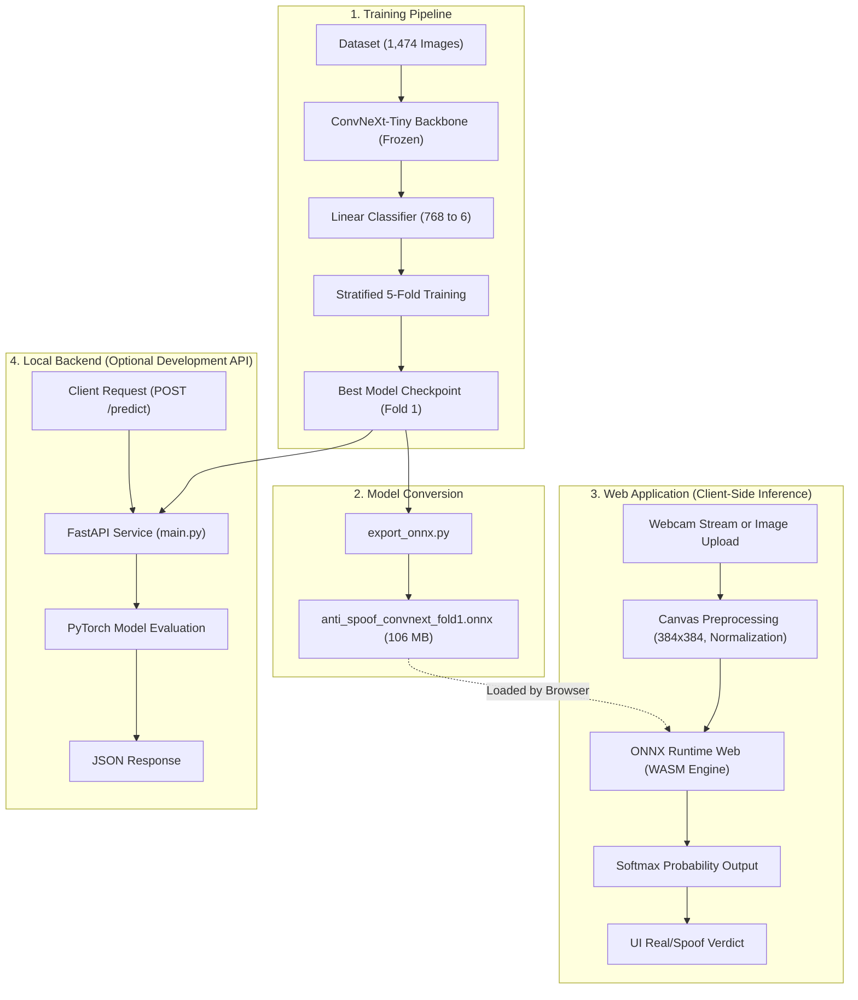

# Face Anti-Spoofing System

This repository provides an end-to-end face anti-spoofing solution. The system determines whether a face image is genuine or a spoof attack. It includes a machine learning training pipeline, an ONNX model exporter, a local FastAPI backend, and a client-side web application running entirely in the browser.

---

## Key Features

- Client-side inference: Runs directly in modern web browsers using ONNX Runtime Web and WebAssembly (WASM).
- Zero server cost for production: The public web application requires no dedicated backend or GPU server.
- Deep learning model: Powered by a fine-tuned ConvNeXt-Tiny architecture.
- Multi-class spoof detection: Detects genuine faces and five distinct spoof attack categories.
- Local development API: Includes a FastAPI service for testing PyTorch checkpoints directly.

---

## System Architecture

The system contains four core parts: model training, model export, client-side web inference, and an optional local backend API.

### Architecture Diagram



### Architecture Breakdown

1. Model Backbone:
   - Uses ConvNeXt-Tiny pretrained on ImageNet-1k.
   - The convolutional feature backbone is frozen during training to preserve learned features.
   - A single linear head maps 768 extracted features to 6 output classes.

2. Preprocessing Pipeline:
   - Resizes input images to 384x384 pixels.
   - Normalizes color values using ImageNet mean `(0.485, 0.456, 0.406)` and standard deviation `(0.229, 0.224, 0.225)`.
   - The preprocessing logic is identical across Python (`Albumentations`) and JavaScript (`HTML Canvas`).

3. Client-Side Browser Inference:
   - The exported ONNX model runs locally in the browser via ONNX Runtime Web.
   - WebAssembly (WASM) executes model tensor math efficiently on the user device.
   - User camera frames and images stay in the browser and are never sent to external servers.

4. Local Backend Service:
   - Built with FastAPI for debugging and local testing.
   - Reads PyTorch checkpoints directly and serves prediction endpoints over HTTP.

---

## Target Classes

The classifier outputs probabilities for six distinct categories:

| Class Name | Type | Description |
|---|---|---|
| realperson | Real | Genuine, live human face. |
| fake_unknown | Spoof | General or unidentified spoof attack. |
| fake_mask | Spoof | Physical mask worn over the face. |
| fake_mannequin | Spoof | Mannequin head, doll, or synthetic model. |
| fake_screen | Spoof | Face displayed on a monitor, phone, or tablet. |
| fake_printed | Spoof | Printed photo or paper cutout of a face. |

---

## Model Specifications and Performance

- Base Architecture: ConvNeXt-Tiny (pretrained on ImageNet-1k)
- Input Shape: 1 x 3 x 384 x 384 (Batch, RGB Channels, Height, Width)
- Dataset Size: 1,652 images initially; 1,474 images after deduplication (178 duplicates removed)
- Validation Strategy: Stratified 5-Fold Cross-Validation
- Training Hyperparameters:
  - Epochs: 15 per fold
  - Batch size: 32
  - Loss function: Weighted Focal Loss (gamma = 2.18)
  - Optimizer: AdamW (learning rate = 9.74e-4, weight decay = 1.97e-5)
  - Learning rate scheduler: CosineAnnealingLR
- Experimental Results:
  - 5-Fold Mean Macro F1: 0.9034 +/- 0.0149
  - Best Fold (Fold 1) Macro F1: 0.9295
  - Best Fold Validation Accuracy: 0.9356 (tested on 295 validation images)

---

## Project Structure

```text
anti-spoofing/
|-- backend/
|   |-- classes.json               # Ordered list of target classes
|   |-- export_onnx.py             # Converts PyTorch checkpoint to ONNX format
|   |-- main.py                    # FastAPI service for local inference
|   |-- requirements.txt           # Dependencies for running the FastAPI service
|   |-- requirements-export.txt    # Dependencies for ONNX model export
|   `-- README.md                  # Local backend documentation
|-- notebook/
|   `-- Master_Optuna_KFold_AntiSpoofing_v2_Documented_savedrive_freeze_backbone.ipynb
|                                  # Complete training and evaluation notebook
|-- web/
|   |-- index.html                 # Single-page web app with ONNX Runtime Web
|   |-- anti_spoof_convnext_fold1.onnx # Exported ONNX model file (approx. 106 MB)
|   |-- .vercelignore              # Deployment ignore file for Vercel
|   `-- README.md                  # Deployment instructions for static hosts
|-- .gitignore                     # Git ignore rules
`-- README.md                      # Main project documentation
```

---

## Getting Started

### 1. Run the Web Application (Recommended)

The web application runs entirely on static files and does not require Python or GPU setup.

1. Open your terminal and enter the `web` folder:
   ```bash
   cd web
   ```

2. Start a local HTTP server:
   ```bash
   python -m http.server 5500
   ```

3. Open your browser and navigate to:
   ```text
   http://localhost:5500
   ```

4. Wait for the status indicator to show that the model is loaded. You can test face liveness using your webcam or by uploading image files.

Note: Always use a local HTTP server (`http://localhost:...`). Do not open `index.html` directly with the `file://` protocol because browsers restrict camera access and WebAssembly scripts on local file paths.

---

### 2. Run the Local Backend (FastAPI)

Use the backend server if you want to test PyTorch model checkpoints via HTTP.

1. Navigate to the `backend` folder:
   ```bash
   cd backend
   ```

2. Create and activate a Python virtual environment:
   ```bash
   python -m venv venv
   # Windows:
   venv\Scripts\activate
   # Linux/macOS:
   source venv/bin/activate
   ```

3. Install required packages:
   ```bash
   pip install -r requirements.txt
   ```

4. Make sure your checkpoint folder (such as `master_convnext_fold1.pth`) exists inside the `backend` directory.

5. Start the backend server:
   ```bash
   uvicorn main:app --reload --port 8000
   ```

6. Verify the server:
   - Check health status at `http://localhost:8000/health`.
   - Send an image for inference:
     ```bash
     curl -X POST http://localhost:8000/predict -F "file=@path/to/image.jpg"
     ```

---

### 3. Export Checkpoints to ONNX

To re-export a PyTorch checkpoint to ONNX format for the browser:

1. Install export requirements:
   ```bash
   pip install -r backend/requirements-export.txt
   ```

2. Run the export script:
   ```bash
   python backend/export_onnx.py
   ```

3. The script verifies that the ONNX model outputs match PyTorch outputs within numerical tolerance. It saves the resulting model file to `web/anti_spoof_convnext_fold1.onnx`.

---

## Deployment Options

### Hugging Face Static Space
- Create a new Space on Hugging Face using the **Static** SDK.
- Upload all files from the `web/` folder into the root of the Space:
  - `index.html`
  - `anti_spoof_convnext_fold1.onnx`
  - `README.md`
- The Space serves the web application immediately without container configuration.

### Vercel
- The `web/` folder is configured for Vercel deployment:
  ```bash
  cd web
  npx vercel --prod
  ```
- `.vercelignore` prevents uploading the 106 MB model file to keep the deployment within Vercel limits.
- When accessed on non-local domains, `index.html` automatically streams the ONNX model from the public Hugging Face Space CDN.

---

## License

This project is intended for research, educational, and development purposes.
